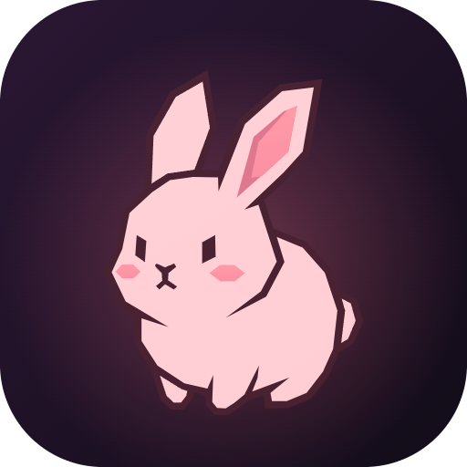
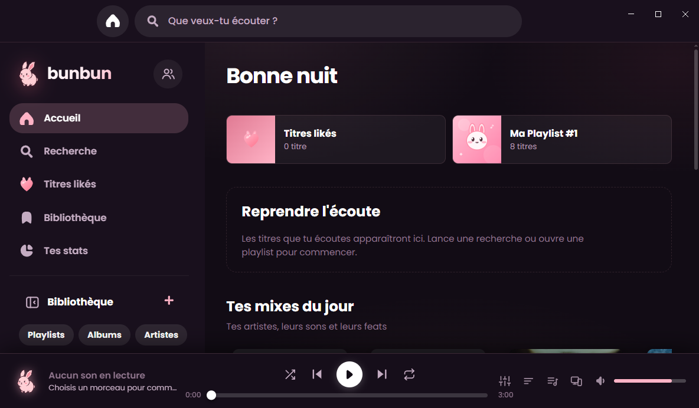
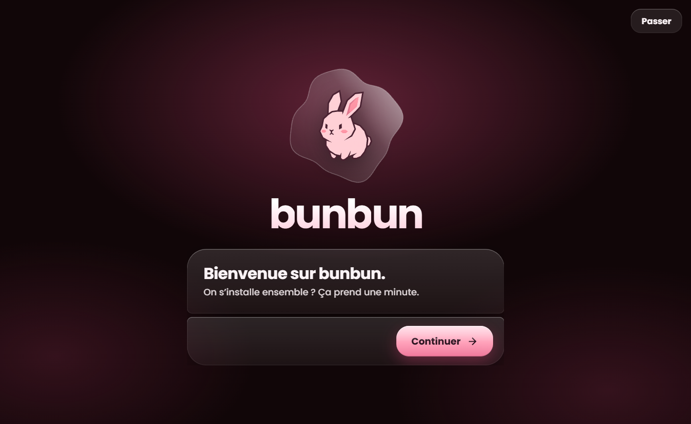

# bunbun

**Ta musique, tes amis, un lecteur qui a du caractère.**

Sur Windows, Android et [dans ton navigateur](https://bunbun-puce.vercel.app).

 

&nbsp;

[Ouvrir le site](https://bunbun-puce.vercel.app) · [Rejoindre le Discord](https://discord.gg/eTkQPXm9rt) · [Toutes les versions](https://github.com/enwrk/bunbun-releases/releases)

 

 

## Écouter

- **Tes playlists partout.** Connecte-toi avec Discord : tes playlists et tes titres likés te suivent sur tous tes appareils. Tu peux aussi importer celles que tu as déjà.
- **Des paroles synchronisées**, en plein écran si tu veux.
- **Le vinyle.** Attrape le disque et le son suit ta main, lentement, vite ou à l'envers.
- **Le son à ton goût.** Égaliseur, réverbération, vitesse, tonalité, et l'effet « son d'à côté » qui fait sonner la musique depuis la pièce voisine.
- **Tes stats**, et un récap du mois en image à partager.

## Avec tes amis

- **Écouter ensemble**, en direct, en vous proposant des sons.
- **Des playlists collab**, à plusieurs.
- **Des commentaires à la seconde** : laisse un mot à un moment d'un son, tes amis le voient passer au bon endroit.
- **Des cassettes en 3D.** Offre une playlist avec ton étiquette écrite à la main. À la moitié, il faut la retourner pour écouter la face B.
- **Des capsules** : scelle une playlist et un message, à ouvrir dans un mois ou dans un an.

 

 

## Ce que les applis ajoutent

| Windows | Android |
|---|---|
| La musique continue fenêtre réduite ou derrière un jeu | La musique continue écran éteint |
| Écoute hors ligne des sons déjà écoutés | Notification et écran verrouillé |
| Mini-lecteur toujours devant, pochette seule ou avec paroles | Widget sur l'écran d'accueil |
| Statut Discord avec la pochette et le temps restant | Boutons des écouteurs Bluetooth |
| Lecture, suivant et précédent depuis le lapin près de l'horloge | Réveil en musique |

 

 

## Installer

**Windows** : télécharge [`bunbun-Setup.exe`](https://github.com/enwrk/bunbun-releases/releases/latest/download/bunbun-Setup.exe) et lance-le. Si Windows affiche « Windows a protégé votre ordinateur », choisis **Informations complémentaires**, puis **Exécuter quand même**.

**Android** : télécharge [`bunbun.apk`](https://github.com/enwrk/bunbun-releases/releases/latest/download/bunbun.apk) sur ton téléphone, ouvre-le, puis autorise l'installation quand Android le demande.

Le site et les applis se mettent à jour d'eux-mêmes. Android te demande juste de confirmer.

 

bunbun · <a href="https://bunbun-puce.vercel.app">bunbun-puce.vercel.app</a>

