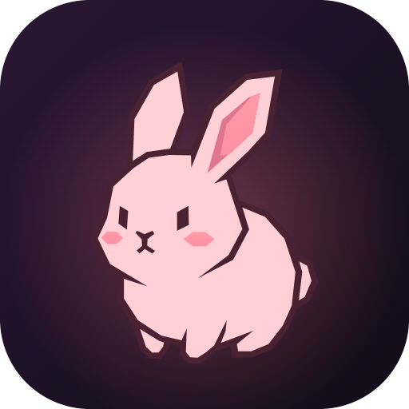

# bunbun

**Ta musique, sur ton PC et ton téléphone.**

&nbsp;

 

 

## 💻 Windows

| | |
|---|---|
| 🎧 **Jamais coupé** | La musique continue fenêtre réduite, cachée ou derrière un jeu. |
| 📌 **Mini-lecteur toujours devant** | Un petit lecteur flottant au-dessus de tout le reste. |
| 🖼️ **Pochette seule** | Juste la jaquette, à poser dans un coin de l'écran. |
| 🎤 **Pochette + paroles** | Les paroles synchronisées défilent en direct. `Ctrl+Alt+M` passe d'une vue à l'autre. |
| 💬 **Statut Discord** | « Écoute bunbun » avec la pochette et le temps restant, sur ton compte. |
| 🐰 **Zone de notification** | Lecture, suivant, précédent sans ouvrir la fenêtre, lancement au démarrage. |

## 📱 Android

| | |
|---|---|
| 🌙 **Écran éteint** | La musique continue, même dans une autre appli. |
| 🔔 **Notification** | Pochette, titre, temps, lecture/pause, suivant, précédent, aussi sur l'écran verrouillé. |
| 🧩 **Widget 4x1** | Pochette, titre, artiste, lecture/pause et suivant sur l'écran d'accueil, même hors ligne. |
| 🎧 **Écouteurs** | Les boutons des écouteurs Bluetooth marchent. |

## ⬇️ Installer

**Windows** — télécharge [`bunbun-Setup.exe`](https://github.com/enwrk/bunbun-releases/releases/latest/download/bunbun-Setup.exe) et lance-le.
Si Windows affiche *« Windows a protégé votre ordinateur »* : **Informations complémentaires** → **Exécuter quand même**.

**Android** — télécharge [`bunbun.apk`](https://github.com/enwrk/bunbun-releases/releases/latest/download/bunbun.apk) sur ton téléphone, ouvre-le, puis autorise *« installer des applis inconnues »* quand Android le demande.

Ensuite, connecte-toi avec Discord comme sur le site : tes playlists et tes titres likés sont déjà là.

## ✨ Mises à jour

- **Le site** à l'intérieur des applis est toujours la dernière version.
- **Windows** se met à jour tout seul au lancement, quand aucune musique ne joue.
- **Android** te propose la nouvelle version au lancement (Android demande toujours une confirmation).

 

Fait avec 🩷 par bunbun · <a href="https://bunbun-puce.vercel.app">bunbun-puce.vercel.app</a>

